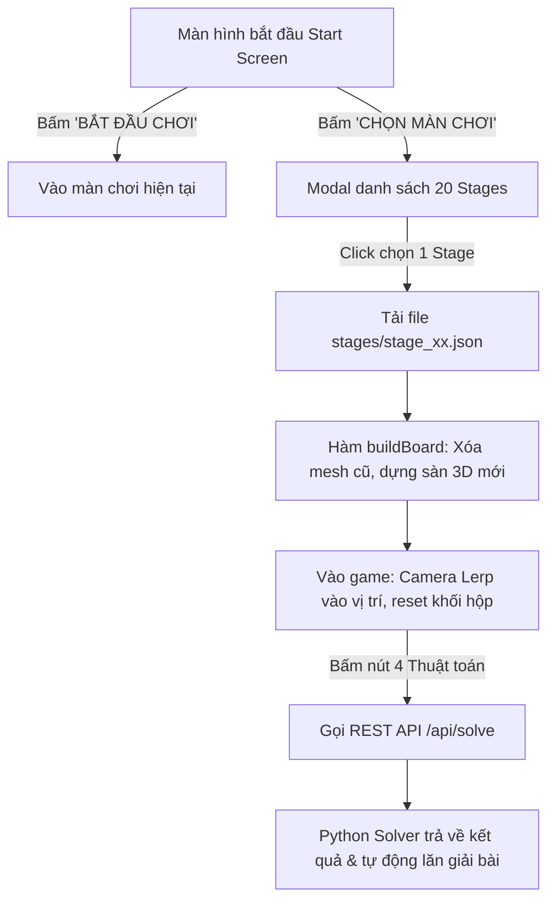

# TÀI LIỆU HƯỚNG DẪN BỔ SUNG GIAO DIỆN MÀN HÌNH BẮT ĐẦU & HUB 20 MÀN CHƠI (BLOXORZ 3D)

> **Dự án**: Bloxorz Solver - HCMUS AI Project 1  
> **Người thực hiện**: Trưởng nhóm (paneer) - Phụ trách Kiến trúc Core, Web GUI 3D & Benchmark  
> **Cam kết**: Toàn bộ code chỉ lưu cục bộ, **TUYỆT ĐỐI KHÔNG PUSH GITHUB** theo đúng yêu cầu.

---

## 1. TỔNG QUAN KIẾN TRÚC NÂNG CẤP

Để biến ứng dụng Bloxorz 3D từ một màn hình chơi đơn lẻ thành một **Game Studio chuyên nghiệp**, hệ thống giao diện web (`web/index.html`) và web server (`web/server.py`) được bổ sung 5 thành phần cốt lõi:



### Các tính năng mới được bổ sung:
1. **Start Screen Overlay (`#start-screen`)**:
   - Giao diện Glassmorphism đen mờ sâu thẳm kết hợp hiệu ứng neon Cyberpunk (`#00f2fe`).
   - Camera 3D tự động xoay nhẹ nhàng xung quanh bàn cờ (Cinematic Orbit) khi người chơi chưa vào game.
   - Hai nút bấm hành động chính: **"BẮT ĐẦU CHƠI"** (vào thẳng màn 1) và **"CHỌN MÀN CHƠI (20 STAGES)"** (mở kho lưu trữ màn chơi).
2. **Stage Selector Modal (`#stage-modal`)**:
   - Hộp thoại popup hiển thị dạng lưới (Grid) 20 màn chơi từ `stage_01.json` đến `stage_20.json`.
   - Mỗi thẻ card hiển thị số thứ tự, tên màn, huy hiệu độ khó (Easy, Medium, Hard, Expert, Master) và loại cơ chế đặc trưng (Gạch thường, Gạch vỡ, Cầu nối, Tách khối).
   - Có thể mở lại bất cứ lúc nào trong khi đang chơi thông qua nút **"🗺️ Đổi Màn Chơi"** trên thanh HUD bên phải.
3. **Bộ dựng bàn cờ 3D tự động (`buildBoard`)**:
   - Tự động dọn dẹp các mesh Three.js cũ khi chuyển màn.
   - Quét ma trận 2D của stage để sinh mesh tương ứng:
     - `1`: Sàn bê tông khối xám với texture kim loại viền neon.
     - `2`: Gạch vỡ màu cam phát quang (sụp đổ khi khối hộp đứng thẳng).
     - `3`: Cầu nối màu cyan phát quang.
     - `4`: Công tắc mềm hình trụ tròn màu vàng.
     - `5`: Công tắc nặng hình dấu X màu đỏ hồng.
     - `6`: Công tắc tách khối hình khối bát diện màu tím.
     - `9`: Ô đích (Hố đen viền vàng phát quang).
   - Tự động tính toán tâm bàn cờ để căn chỉnh góc nhìn camera lý tưởng cho mọi kích cỡ bản đồ.
4. **Backend Server (`web/server.py`) bổ sung endpoint `/stages/<filename>`**:
   - Phục vụ trực tiếp các file JSON từ thư mục `stages/` về trình duyệt mà không cần chuyển thư mục hay sao chép file.

---

## 2. GIẢI THÍCH CHI TIẾT TỪNG PHẦN CODE

### 2.1. Cấu trúc HTML & Giao diện Modal
- **Thẻ `#start-screen`**: Được đặt ở lớp `z-index: 50`, phủ kín toàn màn hình với hiệu ứng mờ nhòe kính cường lực (`backdrop-filter: blur(25px)`). Khi người chơi ấn bắt đầu, class `.hidden` sẽ kích hoạt hiệu ứng fade-out mượt mà bằng CSS transition `cubic-bezier`.
- **Thẻ `#stage-modal`**: Nằm ở lớp `z-index: 60`, chứa `#stage-grid-container`. Khung lưới này sử dụng CSS Grid tự co giãn theo chiều rộng (`minmax(210px, 1fr)`). Khi người dùng ấn phím `Escape` hoặc nút `✕`, modal lập tức đóng lại.

### 2.2. CSS Hiệu ứng Glassmorphism & Cyberpunk
- Sử dụng biến màu CSS toàn cục `:root` để chuẩn hóa tone màu xanh cyan điện tử tử viền neon (`--cyan-glow: #00f2fe`), bảng điều khiển mờ sâu (`rgba(11, 17, 32, 0.82)`), và viền phản quang (`rgba(255, 255, 255, 0.12)`).
- Hiệu ứng đổ bóng `box-shadow` nhiều tầng kết hợp `filter: drop-shadow` giúp các khối hộp và chữ hiển thị nổi bật trên nền không gian 3D.

### 2.3. Khởi tạo mảng dữ liệu 20 Stages (`ALL_STAGES_INFO`)
Để hiển thị đầy đủ thông tin mô tả cho 20 màn chơi trong popup, một mảng JavaScript được cấu hình sẵn:
```javascript
const ALL_STAGES_INFO = [
  { id: "stage_01.json", name: "The Beginning", diff: "easy", mech: "Cơ bản" },
  { id: "stage_02.json", name: "S-Curve", diff: "easy", mech: "Đổi hướng lăn" },
  { id: "stage_03.json", name: "Narrow Spiral", diff: "easy", mech: "Hành lang hẹp" },
  { id: "stage_04.json", name: "Stepping Stones", diff: "medium", mech: "Đảo nối chéo" },
  { id: "stage_05.json", name: "The Labyrinth Island", diff: "medium", mech: "Mê cung sàn" },
  { id: "stage_06.json", name: "Fragile Runway", diff: "medium", mech: "Gạch vỡ màu cam" },
  { id: "stage_07.json", name: "Checkerboard Fragile", diff: "medium", mech: "Gạch vỡ so le" },
  { id: "stage_08.json", name: "The Thin Bridge", diff: "hard", mech: "Cầu gạch vỡ hẹp" },
  { id: "stage_09.json", name: "Fragile Matrix", diff: "hard", mech: "Ma trận gạch vỡ" },
  { id: "stage_10.json", name: "First Bridge", diff: "medium", mech: "Công tắc mềm & Cầu" },
  { id: "stage_11.json", name: "Heavy Switch Trial", diff: "hard", mech: "Công tắc nặng chữ X" },
  { id: "stage_12.json", name: "Dual Bridge Causeway", diff: "hard", mech: "2 cầu nối liên hoàn" },
  { id: "stage_13.json", name: "Toggle Bypass", diff: "hard", mech: "Bẫy đảo trạng thái" },
  { id: "stage_14.json", name: "Permanent Gate", diff: "hard", mech: "Mở cầu vĩnh viễn" },
  { id: "stage_15.json", name: "The Island Outpost", diff: "hard", mech: "Trạm đảo biệt lập" },
  { id: "stage_16.json", name: "Fragile Pass with Bridge", diff: "expert", mech: "Gạch vỡ + Cầu nối" },
  { id: "stage_17.json", name: "The Perilous Peak", diff: "expert", mech: "Công tắc nặng + Gạch vỡ" },
  { id: "stage_18.json", name: "Teleport Split Trial", diff: "expert", mech: "Tách khối 1x1x1" },
  { id: "stage_19.json", name: "The Citadel Maze", diff: "expert", mech: "Pháo đài hỗn hợp" },
  { id: "stage_20.json", name: "Grandmaster Void", diff: "master", mech: "Thử thách Master tối thượng" }
];
```

### 2.4. Hàm nạp màn chơi động `loadStageFile(stageFilename)`
```javascript
async function loadStageFile(stageFilename) {
  currentStageFile = stageFilename;
  try {
    const res = await fetch(`/stages/${stageFilename}`);
    const data = await res.json();
    buildBoard(data);
  } catch (e) {
    console.error("Không thể tải file màn chơi:", e);
  }
}
```
Khi người dùng chọn một màn chơi từ danh sách, hàm sẽ gửi yêu cầu HTTP GET đến máy chủ Python để lấy cấu trúc ma trận, sau đó gọi `buildBoard(data)` để vẽ lại toàn bộ bàn cờ trong Three.js scene.

### 2.5. Camera Cinematic Orbit & Chuyển cảnh mềm
Trong vòng lặp dựng hình `renderLoop()`:
- Khi `!inGameActive` (đang ở màn hình Start Screen): Biến góc quay `orbitAngle` tăng dần mỗi frame (`orbitAngle += 0.002`). Tọa độ `x` và `z` của camera được tính theo hàm `sin` và `cos`, tạo chuyển động xoay 360 độ ngắm bàn cờ từ trên cao.
- Khi người chơi bấm vào chơi: `inGameActive = true`. Camera sử dụng thuật toán nội suy tuyến tính `lerp(targetCamPos, 0.05)` để lướt êm ái về vị trí quan sát tiêu chuẩn.

---

## 3. TOÀN BỘ MÃ NGUỒN HOÀN CHỈNH CHO `web/index.html`

File này đã được cập nhật trực tiếp trong thư mục `web/index.html`. Dưới đây là nội dung toàn vẹn kèm chú thích chi tiết để paneer tiện tra cứu:

```html
<!DOCTYPE html>
<html lang="vi">
<head>
  <meta charset="UTF-8">
  <meta name="viewport" content="width=device-width, initial-scale=1.0">
  <title>Bloxorz 3D - AI Solver Studio & Stage Hub</title>
  
  <!-- Font chữ hiện đại: Plus Jakarta Sans và JetBrains Mono -->
  <link rel="preconnect" href="https://fonts.googleapis.com">
  <link rel="preconnect" href="https://fonts.gstatic.com" crossorigin>
  <link href="https://fonts.googleapis.com/css2?family=Plus+Jakarta+Sans:wght@400;500;600;700;800&family=JetBrains+Mono:wght@500;700;800&display=swap" rel="stylesheet">
  
  <!-- Thư viện Three.js WebGL 3D -->
  <script src="https://cdnjs.cloudflare.com/ajax/libs/three.js/r128/three.min.js"></script>

  <style>
    /* =========================================================================
       1. CSS TOÀN CỤC & BẢNG MÀU CHỦ ĐẠO (CYBERPUNK GLASSMORPHISM)
       ========================================================================= */
    :root {
      --bg-dark: #060913;
      --cyan-glow: #00f2fe;
      --blue-accent: #38bdf8;
      --gold-glow: #f59e0b;
      --emerald-glow: #10b981;
      --rose-glow: #f43f5e;
      --purple-glow: #a855f7;
      --panel-surface: rgba(11, 17, 32, 0.82);
      --panel-border: rgba(255, 255, 255, 0.12);
      --text-main: #f8fafc;
      --text-sub: #94a3b8;
    }

    * { box-sizing: border-box; margin: 0; padding: 0; user-select: none; }

    body {
      background: radial-gradient(circle at 45% 40%, #0d1527 0%, #060913 60%, #020408 100%);
      color: var(--text-main);
      font-family: 'Plus Jakarta Sans', sans-serif;
      overflow: hidden;
      width: 100vw; height: 100vh;
    }

    #webgl-canvas {
      position: absolute; top: 0; left: 0; width: 100%; height: 100%; z-index: 1;
    }

    .vignette {
      position: absolute; inset: 0; pointer-events: none; z-index: 2;
      background: radial-gradient(circle at 45% 45%, transparent 35%, rgba(2, 4, 8, 0.75) 100%);
      box-shadow: inset 0 0 100px rgba(0, 0, 0, 0.9);
    }

    /* =========================================================================
       2. MÀN HÌNH BẮT ĐẦU (START SCREEN OVERLAY)
       ========================================================================= */
    #start-screen {
      position: fixed; inset: 0; z-index: 50;
      background: radial-gradient(circle at center, rgba(13, 21, 39, 0.88) 0%, rgba(3, 7, 18, 0.96) 100%);
      backdrop-filter: blur(25px);
      -webkit-backdrop-filter: blur(25px);
      display: flex; flex-direction: column; align-items: center; justify-content: center;
      transition: opacity 0.5s cubic-bezier(0.16, 1, 0.3, 1), visibility 0.5s;
    }

    #start-screen.hidden {
      opacity: 0; visibility: hidden; pointer-events: none;
    }

    .start-content {
      text-align: center; max-width: 640px; padding: 40px;
      display: flex; flex-direction: column; align-items: center; gap: 22px;
    }

    .hero-badge {
      display: inline-flex; align-items: center; gap: 8px;
      font-family: 'JetBrains Mono', monospace; font-size: 12px; font-weight: 700;
      color: var(--cyan-glow); background: rgba(0, 242, 254, 0.1);
      border: 1px solid rgba(0, 242, 254, 0.3); padding: 6px 16px; border-radius: 999px;
      letter-spacing: 1px;
    }

    .hero-title {
      font-size: 58px; font-weight: 800; letter-spacing: -1.5px; line-height: 1.1;
      background: linear-gradient(135deg, #ffffff 40%, #94a3b8 100%);
      -webkit-background-clip: text; -webkit-text-fill-color: transparent;
      filter: drop-shadow(0 10px 25px rgba(0, 242, 254, 0.25));
    }

    .hero-desc {
      font-size: 15px; color: var(--text-sub); line-height: 1.6;
    }

    .start-btn-group {
      display: flex; gap: 16px; width: 100%; margin-top: 10px;
    }

    .btn-hero {
      flex: 1; padding: 16px 28px; border-radius: 14px; font-size: 15px; font-weight: 700;
      font-family: 'Plus Jakarta Sans', sans-serif; cursor: pointer; border: none;
      display: flex; align-items: center; justify-content: center; gap: 10px;
      transition: all 0.25s cubic-bezier(0.16, 1, 0.3, 1);
    }

    .btn-hero-play {
      background: linear-gradient(135deg, var(--cyan-glow), var(--blue-accent));
      color: #030712; box-shadow: 0 0 30px rgba(0, 242, 254, 0.4);
    }
    .btn-hero-play:hover {
      transform: translateY(-3px) scale(1.02); box-shadow: 0 0 45px rgba(0, 242, 254, 0.6);
    }

    .btn-hero-stages {
      background: rgba(255, 255, 255, 0.05); color: #fff;
      border: 1px solid rgba(255, 255, 255, 0.15); backdrop-filter: blur(10px);
    }
    .btn-hero-stages:hover {
      background: rgba(255, 255, 255, 0.12); border-color: rgba(255, 255, 255, 0.3);
      transform: translateY(-3px);
    }

    .hero-tips {
      display: flex; gap: 18px; font-size: 12.5px; color: #64748b; margin-top: 10px;
    }
    .hero-tips span { display: flex; align-items: center; gap: 6px; }

    /* =========================================================================
       3. BẢNG CHỌN MÀN CHƠI (STAGE SELECTION MODAL)
       ========================================================================= */
    #stage-modal {
      position: fixed; inset: 0; z-index: 60;
      background: rgba(3, 7, 18, 0.85); backdrop-filter: blur(25px);
      display: flex; align-items: center; justify-content: center; padding: 30px;
      opacity: 0; visibility: hidden; pointer-events: none;
      transition: all 0.3s cubic-bezier(0.16, 1, 0.3, 1);
    }

    #stage-modal.active {
      opacity: 1; visibility: visible; pointer-events: auto;
    }

    .stage-modal-box {
      width: 1000px; max-width: 95vw; max-height: 85vh;
      background: var(--panel-surface); border: 1px solid var(--panel-border);
      border-radius: 28px; padding: 32px; display: flex; flex-direction: column; gap: 20px;
      box-shadow: 0 25px 80px rgba(0, 0, 0, 0.8), inset 0 1px 0 rgba(255, 255, 255, 0.1);
    }

    .modal-head {
      display: flex; justify-content: space-between; align-items: center;
    }

    .modal-title-group h2 {
      font-size: 24px; font-weight: 800; color: #fff; letter-spacing: -0.5px;
    }
    .modal-title-group p { font-size: 13px; color: var(--text-sub); margin-top: 3px; }

    .btn-modal-close {
      background: rgba(255, 255, 255, 0.06); border: 1px solid rgba(255, 255, 255, 0.1);
      color: #fff; width: 36px; height: 36px; border-radius: 50%; cursor: pointer;
      font-size: 18px; display: flex; align-items: center; justify-content: center;
      transition: all 0.2s;
    }
    .btn-modal-close:hover { background: rgba(255, 255, 255, 0.15); transform: rotate(90deg); }

    /* Lưới 20 Stages */
    .stage-grid {
      display: grid; grid-template-columns: repeat(auto-fill, minmax(210px, 1fr));
      gap: 14px; overflow-y: auto; padding-right: 6px;
    }
    .stage-grid::-webkit-scrollbar { width: 6px; }
    .stage-grid::-webkit-scrollbar-thumb { background: rgba(255, 255, 255, 0.1); border-radius: 3px; }

    .stage-card {
      background: rgba(255, 255, 255, 0.03); border: 1px solid rgba(255, 255, 255, 0.08);
      border-radius: 16px; padding: 16px; cursor: pointer; display: flex; flex-direction: column;
      gap: 10px; transition: all 0.2s cubic-bezier(0.16, 1, 0.3, 1); position: relative;
    }
    .stage-card:hover {
      background: rgba(0, 242, 254, 0.08); border-color: var(--cyan-glow);
      transform: translateY(-3px); box-shadow: 0 10px 25px rgba(0, 242, 254, 0.15);
    }
    .stage-card.active-stage {
      background: rgba(0, 242, 254, 0.15); border-color: var(--cyan-glow);
      box-shadow: 0 0 20px rgba(0, 242, 254, 0.25);
    }

    .stage-card-top {
      display: flex; justify-content: space-between; align-items: center;
    }
    .stage-num {
      font-family: 'JetBrains Mono', monospace; font-size: 12px; font-weight: 800; color: var(--cyan-glow);
    }
    .diff-badge {
      font-size: 10px; font-weight: 700; padding: 2px 8px; border-radius: 999px; text-transform: uppercase;
    }
    .diff-easy { background: rgba(16, 185, 129, 0.15); color: #34d399; border: 1px solid rgba(16, 185, 129, 0.3); }
    .diff-medium { background: rgba(56, 189, 248, 0.15); color: #38bdf8; border: 1px solid rgba(56, 189, 248, 0.3); }
    .diff-hard { background: rgba(245, 158, 11, 0.15); color: #fbbf24; border: 1px solid rgba(245, 158, 11, 0.3); }
    .diff-expert { background: rgba(168, 85, 247, 0.15); color: #c084fc; border: 1px solid rgba(168, 85, 247, 0.3); }
    .diff-master { background: rgba(244, 63, 94, 0.15); color: #fb7185; border: 1px solid rgba(244, 63, 94, 0.3); }

    .stage-name {
      font-size: 14px; font-weight: 700; color: #fff; line-height: 1.3;
    }
    .stage-mech {
      font-size: 11.5px; color: var(--text-sub); display: flex; align-items: center; gap: 6px;
    }

    /* =========================================================================
       4. GIAO DIỆN IN-GAME (HUD HEADER & SIDEBAR)
       ========================================================================= */
    .brand-dock {
      position: absolute; top: 30px; left: 36px; z-index: 10;
      display: flex; flex-direction: column; gap: 8px;
    }
    .brand-title {
      font-size: 30px; font-weight: 800; letter-spacing: -0.5px;
      background: linear-gradient(135deg, #ffffff 30%, #94a3b8 100%);
      -webkit-background-clip: text; -webkit-text-fill-color: transparent;
    }
    .brand-badge {
      display: inline-flex; align-items: center; gap: 8px;
      font-family: 'JetBrains Mono', monospace; font-size: 11.5px; font-weight: 700;
      color: var(--cyan-glow); background: rgba(0, 242, 254, 0.08);
      border: 1px solid rgba(0, 242, 254, 0.3); padding: 5px 14px; border-radius: 999px;
    }
    .pulse-dot { width: 7px; height: 7px; border-radius: 50%; background: var(--cyan-glow); box-shadow: 0 0 10px var(--cyan-glow); }

    .hud-sidebar {
      position: absolute; top: 30px; right: 36px; bottom: 30px; width: 380px;
      background: var(--panel-surface); backdrop-filter: blur(30px);
      border: 1px solid var(--panel-border); border-radius: 26px;
      box-shadow: 0 30px 80px rgba(0, 0, 0, 0.75); z-index: 10; padding: 24px;
      display: flex; flex-direction: column; gap: 14px; overflow-y: auto;
    }
    .hud-sidebar::-webkit-scrollbar { display: none; }

    .card {
      background: rgba(255, 255, 255, 0.035); border: 1px solid rgba(255, 255, 255, 0.07);
      border-radius: 18px; padding: 15px 18px;
    }
    .card-head {
      font-family: 'JetBrains Mono', monospace; font-size: 11px; font-weight: 700;
      text-transform: uppercase; letter-spacing: 1.2px; color: var(--text-sub);
      margin-bottom: 10px; display: flex; justify-content: space-between; align-items: center;
    }

    .telemetry-row { display: flex; justify-content: space-between; align-items: center; margin-bottom: 8px; }
    .telemetry-row:last-child { margin-bottom: 0; }
    .telemetry-key { font-size: 13px; color: var(--text-sub); }
    .telemetry-val { font-family: 'JetBrains Mono', monospace; font-size: 14px; font-weight: 700; color: #fff; }
    .counter-hero { font-size: 26px; color: var(--cyan-glow); }

    .status-badge {
      font-family: 'JetBrains Mono', monospace; font-size: 11px; font-weight: 800;
      padding: 4px 12px; border-radius: 6px;
    }
    .status-playing { background: rgba(0, 242, 254, 0.12); border: 1px solid var(--cyan-glow); color: var(--cyan-glow); }
    .status-won { background: rgba(16, 185, 129, 0.15); border: 1px solid var(--emerald-glow); color: var(--emerald-glow); }
    .status-fell { background: rgba(244, 63, 94, 0.15); border: 1px solid var(--rose-glow); color: var(--rose-glow); }

    /* Nút chọn Solver */
    .solver-list { display: flex; flex-direction: column; gap: 8px; }
    .solver-btn {
      width: 100%; padding: 12px 14px; border-radius: 12px; border: 1px solid transparent;
      color: #fff; font-family: 'Plus Jakarta Sans', sans-serif; font-size: 13px; font-weight: 600;
      cursor: pointer; display: flex; align-items: center; justify-content: space-between;
      transition: all 0.2s;
    }
    .solver-btn-bfs { background: linear-gradient(135deg, rgba(37, 99, 235, 0.35), rgba(29, 78, 216, 0.2)); border-color: rgba(59, 130, 246, 0.4); }
    .solver-btn-dfs { background: linear-gradient(135deg, rgba(16, 185, 129, 0.35), rgba(5, 150, 105, 0.2)); border-color: rgba(16, 185, 129, 0.4); }
    .solver-btn-ucs { background: linear-gradient(135deg, rgba(245, 158, 11, 0.35), rgba(217, 119, 6, 0.2)); border-color: rgba(245, 158, 11, 0.4); }
    .solver-btn-astar { background: linear-gradient(135deg, rgba(139, 92, 246, 0.4), rgba(124, 58, 237, 0.25)); border-color: rgba(167, 139, 250, 0.5); }
    .solver-btn:hover { transform: translateY(-2px); filter: brightness(1.15); }

    .tag-badge {
      font-family: 'JetBrains Mono', monospace; font-size: 10px; font-weight: 700;
      padding: 2px 7px; border-radius: 5px; background: rgba(0, 0, 0, 0.4); border: 1px solid rgba(255, 255, 255, 0.1);
    }

    .cam-grid { display: grid; grid-template-columns: repeat(3, 1fr); gap: 8px; }
    .cam-btn {
      background: rgba(255, 255, 255, 0.04); border: 1px solid rgba(255, 255, 255, 0.08);
      border-radius: 10px; color: var(--text-sub); font-size: 11.5px; font-weight: 600;
      padding: 8px 4px; cursor: pointer; text-align: center;
      transition: all 0.2s;
    }
    .cam-btn.active, .cam-btn:hover {
      background: rgba(0, 242, 254, 0.15); border-color: var(--cyan-glow); color: #fff;
    }

    .btn-action-ghost {
      width: 100%; padding: 12px; border-radius: 12px; border: 1px solid rgba(255, 255, 255, 0.1);
      background: rgba(255, 255, 255, 0.05); color: #fff; font-size: 13px; font-weight: 600;
      cursor: pointer; display: flex; align-items: center; justify-content: center; gap: 8px;
      transition: all 0.2s;
    }
    .btn-action-ghost:hover { background: rgba(255, 255, 255, 0.12); border-color: rgba(255, 255, 255, 0.25); }

    .btn-open-stages {
      background: linear-gradient(135deg, rgba(0, 242, 254, 0.15), rgba(56, 189, 248, 0.08));
      border: 1px solid rgba(0, 242, 254, 0.35); color: var(--cyan-glow);
    }
    .btn-open-stages:hover {
      background: linear-gradient(135deg, rgba(0, 242, 254, 0.25), rgba(56, 189, 248, 0.15));
      box-shadow: 0 0 20px rgba(0, 242, 254, 0.2);
    }

    .dock-bar {
      position: absolute; bottom: 30px; left: 36px; z-index: 10;
      display: flex; align-items: center; gap: 14px; background: var(--panel-surface);
      backdrop-filter: blur(24px); border: 1px solid var(--panel-border);
      padding: 10px 22px; border-radius: 999px; font-size: 13px; color: var(--text-sub);
    }
    .kbd-chip {
      background: rgba(255, 255, 255, 0.1); border: 1px solid rgba(255, 255, 255, 0.2);
      padding: 2px 7px; border-radius: 5px; color: #fff; font-family: 'JetBrains Mono', monospace; font-size: 11px;
    }
  </style>
</head>
<body>
  <div class="vignette"></div>

  <!-- =========================================================================
       MÀN HÌNH BẮT ĐẦU (START SCREEN OVERLAY)
       ========================================================================= -->
  <div id="start-screen">
    <div class="start-content">
      <div class="hero-badge">HCMUS • AI PROJECT 1 • BLOXORZ 3D</div>
      <h1 class="hero-title">BLOXORZ 3D</h1>
      <p class="hero-desc">
        Hệ thống mô phỏng không gian hình học 3D kết hợp bộ giải thuật toán thông minh
        (BFS, DFS, UCS, A*) trên 20 màn chơi thử thách.
      </p>

      <div class="start-btn-group">
        <button class="btn-hero btn-hero-play" onclick="startGame()">
          <span>▶</span> BẮT ĐẦU CHƠI
        </button>
        <button class="btn-hero btn-hero-stages" onclick="openStageModal()">
          <span>🗺️</span> CHỌN MÀN CHƠI (20 STAGES)
        </button>
      </div>

      <div class="hero-tips">
        <span><span class="kbd-chip">W A S D</span> / <span class="kbd-chip">↑ ↓ ← →</span> Di chuyển</span>
        <span>•</span>
        <span><span class="kbd-chip">R</span> Đặt lại màn</span>
      </div>
    </div>
  </div>

  <!-- =========================================================================
       BẢNG MODAL CHỌN MÀN CHƠI (STAGE SELECTION)
       ========================================================================= -->
  <div id="stage-modal">
    <div class="stage-modal-box">
      <div class="modal-head">
        <div class="modal-title-group">
          <h2>Danh Sách 20 Thử Thách Bloxorz</h2>
          <p>Lựa chọn thử thách để trải nghiệm lăn khối hoặc đo đạc hiệu năng của 4 thuật toán AI.</p>
        </div>
        <button class="btn-modal-close" onclick="closeStageModal()">✕</button>
      </div>

      <div class="stage-grid" id="stage-grid-container">
        <!-- Được sinh động bằng hàm JavaScript populateStageGrid() -->
      </div>
    </div>
  </div>

  <!-- =========================================================================
       GIAO DIỆN IN-GAME (HUD HEADER & SIDEBAR)
       ========================================================================= -->
  <div class="brand-dock">
    <div class="brand-badge"><span class="pulse-dot"></span> BLOXORZ 3D STUDIO</div>
    <div class="brand-title">Bloxorz AI Solver</div>
  </div>

  <div class="hud-sidebar">
    <!-- Thẻ Màn Chơi Hiện Tại -->
    <div class="card">
      <div class="card-head">
        <span>STAGE HIỆN TẠI</span>
        <span class="diff-badge diff-easy" id="hud-stage-diff">EASY</span>
      </div>
      <div class="telemetry-row">
        <span class="telemetry-key" id="hud-stage-name" style="font-weight: 700; color: #fff; font-size: 15px;">Stage 01 - The Beginning</span>
      </div>
      <button class="btn-action-ghost btn-open-stages" onclick="openStageModal()" style="margin-top: 10px;">
        <span>🗺️</span> Đổi Màn Chơi (20 Stages)
      </button>
    </div>

    <!-- Thẻ Trạng Thái & Số Bước -->
    <div class="card">
      <div class="card-head"><span>TRẠNG THÁI KHỐI HỘP</span></div>
      <div class="telemetry-row">
        <span class="telemetry-key">Số bước di chuyển:</span>
        <span class="telemetry-val counter-hero" id="ui-moves">0</span>
      </div>
      <div class="telemetry-row">
        <span class="telemetry-key">Tư thế:</span>
        <span class="telemetry-val" id="ui-orient">Standing (1 × 1)</span>
      </div>
      <div class="telemetry-row">
        <span class="telemetry-key">Trạng thái:</span>
        <span class="status-badge status-playing" id="ui-status">PLAYING</span>
      </div>
    </div>

    <!-- Thẻ Bộ Giải Thuật Toán AI -->
    <div class="card">
      <div class="card-head"><span>BỘ GIẢI THUẬT TOÁN AI</span></div>
      <div class="solver-list">
        <button class="solver-btn solver-btn-bfs" onclick="callPythonSolver('BFS')">
          <span>BFS (Breadth-First)</span>
          <span class="tag-badge">Phúc</span>
        </button>
        <button class="solver-btn solver-btn-dfs" onclick="callPythonSolver('DFS')">
          <span>DFS / IDS</span>
          <span class="tag-badge">Đức</span>
        </button>
        <button class="solver-btn solver-btn-ucs" onclick="callPythonSolver('UCS')">
          <span>UCS (Dijkstra)</span>
          <span class="tag-badge">Trường</span>
        </button>
        <button class="solver-btn solver-btn-astar" onclick="callPythonSolver('ASTAR')">
          <span>A* Search (Manhattan)</span>
          <span class="tag-badge">Quân</span>
        </button>
      </div>
    </div>

    <!-- Thẻ Kết Quả Đo Hiệu Năng -->
    <div class="card">
      <div class="card-head"><span>KẾT QUẢ ĐO HIỆU NĂNG</span></div>
      <div class="telemetry-row">
        <span class="telemetry-key">Thuật toán:</span>
        <span class="telemetry-val" id="bm-algo">---</span>
      </div>
      <div class="telemetry-row">
        <span class="telemetry-key">Thời gian chạy:</span>
        <span class="telemetry-val" id="bm-time">---</span>
      </div>
      <div class="telemetry-row">
        <span class="telemetry-key">Bộ nhớ tiêu thụ:</span>
        <span class="telemetry-val" id="bm-mem">---</span>
      </div>
      <div class="telemetry-row">
        <span class="telemetry-key">Nút mở rộng:</span>
        <span class="telemetry-val" id="bm-nodes">---</span>
      </div>
      <div class="telemetry-row">
        <span class="telemetry-key">Độ dài đường đi:</span>
        <span class="telemetry-val" id="bm-steps">---</span>
      </div>
    </div>

    <!-- Góc Nhìn Camera -->
    <div class="card">
      <div class="card-head"><span>GÓC NHÌN CAMERA</span></div>
      <div class="cam-grid">
        <div class="cam-btn active" id="btn-cam-iso" onclick="setCamera('iso')">Isometric</div>
        <div class="cam-btn" id="btn-cam-side" onclick="setCamera('side')">Side</div>
        <div class="cam-btn" id="btn-cam-top" onclick="setCamera('top')">Top-down</div>
      </div>
    </div>

    <!-- Nút Đặt Lại -->
    <div class="card" style="margin-top: auto;">
      <button class="btn-action-ghost" onclick="resetStage()"><span>🔄</span> Đặt Lại Màn (Phím: R)</button>
    </div>
  </div>

  <div class="dock-bar">
    <span>Điều khiển: <span class="kbd-chip">W</span> <span class="kbd-chip">A</span> <span class="kbd-chip">S</span> <span class="kbd-chip">D</span> hoặc <span class="kbd-chip">↑</span> <span class="kbd-chip">↓</span> <span class="kbd-chip">←</span> <span class="kbd-chip">→</span></span>
    <span>•</span>
    <span>Đặt lại: <span class="kbd-chip">R</span></span>
  </div>

  <canvas id="webgl-canvas"></canvas>

  <script>
    /* =========================================================================
       5. ÂM THANH PROCEDURAL (WEB AUDIO API TỔNG HỢP)
       ========================================================================= */
    const audioCtx = new (window.AudioContext || window.webkitAudioContext)();
    function playAudio(type) {
      if (audioCtx.state === 'suspended') audioCtx.resume();
      const now = audioCtx.currentTime;
      if (type === 'roll') {
        const osc = audioCtx.createOscillator();
        const gain = audioCtx.createGain();
        osc.type = 'triangle';
        osc.frequency.setValueAtTime(140, now);
        osc.frequency.exponentialRampToValueAtTime(45, now + 0.12);
        gain.gain.setValueAtTime(0.25, now);
        gain.gain.exponentialRampToValueAtTime(0.001, now + 0.12);
        osc.connect(gain);
        gain.connect(audioCtx.destination);
        osc.start(now);
        osc.stop(now + 0.12);
      } else if (type === 'win') {
        [523.25, 659.25, 783.99, 1046.50].forEach((freq, idx) => {
          const osc = audioCtx.createOscillator();
          const gain = audioCtx.createGain();
          osc.type = 'sine';
          osc.frequency.setValueAtTime(freq, now + idx * 0.1);
          gain.gain.setValueAtTime(0.2, now + idx * 0.1);
          gain.gain.exponentialRampToValueAtTime(0.001, now + idx * 0.1 + 0.35);
          osc.connect(gain);
          gain.connect(audioCtx.destination);
          osc.start(now + idx * 0.1);
          osc.stop(now + idx * 0.1 + 0.35);
        });
      } else if (type === 'fall') {
        const osc = audioCtx.createOscillator();
        const gain = audioCtx.createGain();
        osc.type = 'sawtooth';
        osc.frequency.setValueAtTime(120, now);
        osc.frequency.exponentialRampToValueAtTime(30, now + 0.4);
        gain.gain.setValueAtTime(0.3, now);
        gain.gain.exponentialRampToValueAtTime(0.001, now + 0.4);
        osc.connect(gain);
        gain.connect(audioCtx.destination);
        osc.start(now);
        osc.stop(now + 0.4);
      }
    }

    /* =========================================================================
       6. TỰ SINH CHẤT LIỆU TEXTURE CHO BÀN CỜ VÀ KHỐI HỘP
       ========================================================================= */
    function makeTileTexture() {
      const c = document.createElement('canvas'); c.width = 512; c.height = 512;
      const ctx = c.getContext('2d');
      const grad = ctx.createLinearGradient(0, 0, 512, 512);
      grad.addColorStop(0, '#2a374d'); grad.addColorStop(1, '#151d2d');
      ctx.fillStyle = grad; ctx.fillRect(0, 0, 512, 512);
      for (let i = 0; i < 9000; i++) {
        ctx.fillStyle = Math.random() > 0.5 ? 'rgba(255,255,255,0.05)' : 'rgba(0,0,0,0.1)';
        ctx.fillRect(Math.random() * 512, Math.random() * 512, 2, 2);
      }
      ctx.strokeStyle = 'rgba(56, 189, 248, 0.45)'; ctx.lineWidth = 6; ctx.strokeRect(6, 6, 500, 500);
      return new THREE.CanvasTexture(c);
    }

    function makeBlockTexture() {
      const c = document.createElement('canvas'); c.width = 512; c.height = 512;
      const ctx = c.getContext('2d');
      const grad = ctx.createLinearGradient(0, 0, 0, 512);
      grad.addColorStop(0, '#c25e16'); grad.addColorStop(1, '#521f03');
      ctx.fillStyle = grad; ctx.fillRect(0, 0, 512, 512);
      for (let y = 0; y < 512; y += 3) {
        ctx.fillStyle = `rgba(255, 220, 160, ${0.05 + Math.sin(y * 0.22) * 0.04})`;
        ctx.fillRect(0, y, 512, 2);
      }
      ctx.strokeStyle = 'rgba(255, 225, 140, 0.85)'; ctx.lineWidth = 10; ctx.strokeRect(5, 5, 502, 502);
      return new THREE.CanvasTexture(c);
    }

    /* =========================================================================
       7. DANH SÁCH 20 STAGES VÀ DỮ LIỆU CẤU TRÚC
       ========================================================================= */
    const ALL_STAGES_INFO = [
      { id: "stage_01.json", name: "The Beginning", diff: "easy", mech: "Cơ bản" },
      { id: "stage_02.json", name: "S-Curve", diff: "easy", mech: "Đổi hướng lăn" },
      { id: "stage_03.json", name: "Narrow Spiral", diff: "easy", mech: "Hành lang hẹp" },
      { id: "stage_04.json", name: "Stepping Stones", diff: "medium", mech: "Đảo nối chéo" },
      { id: "stage_05.json", name: "The Labyrinth Island", diff: "medium", mech: "Mê cung sàn" },
      { id: "stage_06.json", name: "Fragile Runway", diff: "medium", mech: "Gạch vỡ màu cam" },
      { id: "stage_07.json", name: "Checkerboard Fragile", diff: "medium", mech: "Gạch vỡ so le" },
      { id: "stage_08.json", name: "The Thin Bridge", diff: "hard", mech: "Cầu gạch vỡ hẹp" },
      { id: "stage_09.json", name: "Fragile Matrix", diff: "hard", mech: "Ma trận gạch vỡ" },
      { id: "stage_10.json", name: "First Bridge", diff: "medium", mech: "Công tắc mềm & Cầu" },
      { id: "stage_11.json", name: "Heavy Switch Trial", diff: "hard", mech: "Công tắc nặng chữ X" },
      { id: "stage_12.json", name: "Dual Bridge Causeway", diff: "hard", mech: "2 cầu nối liên hoàn" },
      { id: "stage_13.json", name: "Toggle Bypass", diff: "hard", mech: "Bẫy đảo trạng thái" },
      { id: "stage_14.json", name: "Permanent Gate", diff: "hard", mech: "Mở cầu vĩnh viễn" },
      { id: "stage_15.json", name: "The Island Outpost", diff: "hard", mech: "Trạm đảo biệt lập" },
      { id: "stage_16.json", name: "Fragile Pass with Bridge", diff: "expert", mech: "Gạch vỡ + Cầu nối" },
      { id: "stage_17.json", name: "The Perilous Peak", diff: "expert", mech: "Công tắc nặng + Gạch vỡ" },
      { id: "stage_18.json", name: "Teleport Split Trial", diff: "expert", mech: "Tách khối 1x1x1" },
      { id: "stage_19.json", name: "The Citadel Maze", diff: "expert", mech: "Pháo đài hỗn hợp" },
      { id: "stage_20.json", name: "Grandmaster Void", diff: "master", mech: "Thử thách Master tối thượng" }
    ];

    let currentStageFile = "stage_01.json";
    let currentStageData = null;
    let inGameActive = false;

    // Thiết lập Three.js Scene
    const TILE_SCALE = 2.0;
    const canvas = document.getElementById('webgl-canvas');
    const renderer = new THREE.WebGLRenderer({ canvas, antialias: true });
    renderer.setSize(window.innerWidth, window.innerHeight);
    renderer.setPixelRatio(Math.min(window.devicePixelRatio, 2));
    renderer.shadowMap.enabled = true;
    renderer.shadowMap.type = THREE.PCFSoftShadowMap;

    const scene = new THREE.Scene();
    scene.fog = new THREE.FogExp2(0x060913, 0.012);

    const camera = new THREE.PerspectiveCamera(38, window.innerWidth / window.innerHeight, 0.1, 1000);
    let targetCamPos = new THREE.Vector3(-9, 19, 17);
    let targetCamLook = new THREE.Vector3(7.5, 0, 4.5);
    camera.position.copy(targetCamPos);
    camera.lookAt(targetCamLook);

    // Ánh sáng
    scene.add(new THREE.AmbientLight(0xffffff, 0.75));
    const dirLight = new THREE.DirectionalLight(0xffeedd, 1.9);
    dirLight.position.set(-22, 45, 18); dirLight.castShadow = true;
    scene.add(dirLight);
    scene.add(new THREE.DirectionalLight(0x00f2fe, 0.85));

    // Bụi sao và sàn lưới không gian
    const galaxyGeo = new THREE.BufferGeometry();
    const pos = new Float32Array(1200 * 3);
    for (let i = 0; i < 1200 * 3; i++) pos[i] = (Math.random() - 0.5) * 160;
    galaxyGeo.setAttribute('position', new THREE.BufferAttribute(pos, 3));
    scene.add(new THREE.Points(galaxyGeo, new THREE.PointsMaterial({ size: 0.45, color: 0x38bdf8 })));

    const gridHelper = new THREE.GridHelper(80, 40, 0x00f2fe, 0x1e293b);
    gridHelper.position.y = -8; scene.add(gridHelper);

    // Vật liệu ô sàn
    const tileMat = new THREE.MeshStandardMaterial({ map: makeTileTexture(), roughness: 0.25 });
    const fragileMat = new THREE.MeshStandardMaterial({ color: 0xf97316, roughness: 0.4, emissive: 0x7c2d12, emissiveIntensity: 0.3 });
    const bridgeMat = new THREE.MeshStandardMaterial({ color: 0x00f2fe, roughness: 0.3, emissive: 0x0077aa, emissiveIntensity: 0.4 });
    const sideMat = new THREE.MeshStandardMaterial({ color: 0x182234 });
    const boardGroup = new THREE.Group();
    scene.add(boardGroup);

    // Khối hộp (1x1x2)
    const blockMat = new THREE.MeshStandardMaterial({ map: makeBlockTexture(), roughness: 0.3 });
    const cubeGeo = new THREE.BoxGeometry(TILE_SCALE * 0.92, TILE_SCALE * 0.92, TILE_SCALE * 0.92);
    const blockMaster = new THREE.Group();
    const cubeA = new THREE.Mesh(cubeGeo, blockMat); cubeA.castShadow = true;
    const cubeB = new THREE.Mesh(cubeGeo, blockMat); cubeB.castShadow = true;
    blockMaster.add(cubeA); blockMaster.add(cubeB); scene.add(blockMaster);

    // Biến trạng thái game
    let blockR = 1, blockC = 1, blockOrient = 0, moves = 0, gameState = "PLAYING", isRolling = false;
    let currentGrid = [];

    /* =========================================================================
       8. XÂY DỰNG LẠI BÀN CỜ 3D TỰ ĐỘNG THEO DỮ LIỆU JSON
       ========================================================================= */
    function buildBoard(data) {
      currentStageData = data;
      currentGrid = data.grid;
      
      // Xóa các mesh ô sàn cũ
      while (boardGroup.children.length > 0) {
        boardGroup.remove(boardGroup.children[0]);
      }

      const rows = currentGrid.length;
      const cols = currentGrid[0].length;

      // Căn giữa camera theo kích thước bàn cờ
      targetCamLook.set((cols / 2) * TILE_SCALE, 0, (rows / 2) * TILE_SCALE);
      targetCamPos.set((cols / 2) * TILE_SCALE - 12, 22, (rows / 2) * TILE_SCALE + 14);

      for (let r = 0; r < rows; r++) {
        for (let c = 0; c < cols; c++) {
          const type = currentGrid[r][c];
          if (type === 0) continue; // Khoảng trống
          const x = c * TILE_SCALE, z = r * TILE_SCALE;

          if (type === 9) {
            // Ô đích (Hố đen viền vàng phát quang)
            const frame = new THREE.Mesh(new THREE.BoxGeometry(TILE_SCALE * 0.98, 0.24, TILE_SCALE * 0.98), new THREE.MeshStandardMaterial({ color: 0xffaa00, emissive: 0xff7700 }));
            frame.position.set(x, -0.08, z); boardGroup.add(frame);
            const pit = new THREE.Mesh(new THREE.BoxGeometry(TILE_SCALE * 0.82, 5.0, TILE_SCALE * 0.82), new THREE.MeshBasicMaterial({ color: 0x010204 }));
            pit.position.set(x, -2.5, z); boardGroup.add(pit);
          } else {
            // Ô sàn chuẩn, gạch vỡ hoặc cầu nối
            let mTop = tileMat;
            if (type === 2) mTop = fragileMat;
            else if (type === 3) mTop = bridgeMat;

            const tMesh = new THREE.Mesh(new THREE.BoxGeometry(TILE_SCALE * 0.96, 0.35, TILE_SCALE * 0.96), [sideMat, sideMat, mTop, sideMat, sideMat, sideMat]);
            tMesh.position.set(x, -0.175, z); tMesh.receiveShadow = true;
            boardGroup.add(tMesh);

            // Công tắc mềm (4) hoặc công tắc nặng (5) hoặc tách khối (6)
            if (type === 4) {
              const sw = new THREE.Mesh(new THREE.CylinderGeometry(0.4, 0.45, 0.15, 16), new THREE.MeshStandardMaterial({ color: 0xfacc15, emissive: 0xca8a04 }));
              sw.position.set(x, 0.08, z); boardGroup.add(sw);
            } else if (type === 5) {
              const sw = new THREE.Mesh(new THREE.BoxGeometry(0.7, 0.15, 0.7), new THREE.MeshStandardMaterial({ color: 0xf43f5e, emissive: 0xbe123c }));
              sw.position.set(x, 0.08, z); sw.rotation.y = Math.PI / 4; boardGroup.add(sw);
            } else if (type === 6) {
              const sw = new THREE.Mesh(new THREE.OctahedronGeometry(0.35), new THREE.MeshStandardMaterial({ color: 0xa855f7, emissive: 0x7e22ce }));
              sw.position.set(x, 0.25, z); boardGroup.add(sw);
            }
          }
        }
      }

      // Cập nhật thông tin HUD
      const foundInfo = ALL_STAGES_INFO.find(s => s.id === currentStageFile) || { name: data.name || currentStageFile, diff: "medium" };
      document.getElementById('hud-stage-name').textContent = foundInfo.name;
      const diffEl = document.getElementById('hud-stage-diff');
      diffEl.textContent = foundInfo.diff.toUpperCase();
      diffEl.className = `diff-badge diff-${foundInfo.diff}`;

      // Đặt vị trí khối hộp ban đầu
      resetStage();
    }

    /* =========================================================================
       9. QUẢN LÝ VỊ TRÍ, TƯ THẾ VÀ LĂN KHỐI HỘP TRONG KHÔNG GIAN
       ========================================================================= */
    function resetStage() {
      if (!currentStageData) return;
      blockR = currentStageData.start[0];
      blockC = currentStageData.start[1];
      blockOrient = 0;
      moves = 0;
      gameState = "PLAYING";
      isRolling = false;
      document.getElementById('ui-status').className = 'status-badge status-playing';
      document.getElementById('ui-status').textContent = 'PLAYING';
      syncBlockTransform();
    }

    function syncBlockTransform() {
      const u = TILE_SCALE, half = u * 0.5;
      if (blockOrient === 0) {
        cubeA.position.set(0, half, 0); cubeB.position.set(0, half + u, 0);
        blockMaster.position.set(blockC * u, 0, blockR * u);
      } else if (blockOrient === 1) {
        cubeA.position.set(-half, half, 0); cubeB.position.set(half, half, 0);
        blockMaster.position.set((blockC + 0.5) * u, 0, blockR * u);
      } else if (blockOrient === 2) {
        cubeA.position.set(0, half, -half); cubeB.position.set(0, half, half);
        blockMaster.position.set(blockC * u, 0, (blockR + 0.5) * u);
      }
      blockMaster.rotation.set(0, 0, 0);
      document.getElementById('ui-moves').textContent = moves;
      const orientNames = ["Standing (1 × 1)", "Lying Horizontal", "Lying Vertical"];
      document.getElementById('ui-orient').textContent = orientNames[blockOrient];
    }

    function roll(dir, onComplete = null) {
      if (isRolling || gameState !== "PLAYING") return;
      isRolling = true; playAudio('roll');

      const oldR = blockR, oldC = blockC, oldO = blockOrient;
      let newR = oldR, newC = oldC, newO = oldO;
      if (oldO === 0) {
        if (dir === 'UP') { newR = oldR - 2; newO = 2; }
        else if (dir === 'DOWN') { newR = oldR + 1; newO = 2; }
        else if (dir === 'LEFT') { newC = oldC - 2; newO = 1; }
        else if (dir === 'RIGHT') { newC = oldC + 1; newO = 1; }
      } else if (oldO === 1) {
        if (dir === 'UP') { newR = oldR - 1; newO = 1; }
        else if (dir === 'DOWN') { newR = oldR + 1; newO = 1; }
        else if (dir === 'LEFT') { newC = oldC - 1; newO = 0; }
        else if (dir === 'RIGHT') { newC = oldC + 2; newO = 0; }
      } else if (oldO === 2) {
        if (dir === 'UP') { newR = oldR - 1; newO = 0; }
        else if (dir === 'DOWN') { newR = oldR + 2; newO = 0; }
        else if (dir === 'LEFT') { newC = oldC - 1; newO = 2; }
        else if (dir === 'RIGHT') { newC = oldC + 1; newO = 2; }
      }

      const u = TILE_SCALE, half = u * 0.5, curX = blockMaster.position.x, curZ = blockMaster.position.z;
      let pivot = new THREE.Vector3(), rotAxis = new THREE.Vector3();
      if (dir === 'UP') { rotAxis.set(-1, 0, 0); pivot.set(curX, 0, (oldO === 2) ? curZ - u : curZ - half); }
      else if (dir === 'DOWN') { rotAxis.set(1, 0, 0); pivot.set(curX, 0, (oldO === 2) ? curZ + u : curZ + half); }
      else if (dir === 'LEFT') { rotAxis.set(0, 0, 1); pivot.set((oldO === 1) ? curX - u : curX - half, 0, curZ); }
      else if (dir === 'RIGHT') { rotAxis.set(0, 0, -1); pivot.set((oldO === 1) ? curX + u : curX + half, 0, curZ); }

      const startPos = blockMaster.position.clone();
      const relPos = new THREE.Vector3().subVectors(startPos, pivot);
      const startTime = performance.now();
      const duration = 180; // ms

      function animateRoll(t) {
        const progress = Math.min((t - startTime) / duration, 1.0);
        const ease = 0.5 - Math.cos(progress * Math.PI) * 0.5;
        const angle = ease * (Math.PI / 2);

        const q = new THREE.Quaternion().setFromAxisAngle(rotAxis, angle);
        blockMaster.position.copy(relPos.clone().applyQuaternion(q).add(pivot));
        blockMaster.quaternion.copy(q);

        if (progress < 1.0) {
          requestAnimationFrame(animateRoll);
        } else {
          blockR = newR; blockC = newC; blockOrient = newO; moves++;
          blockMaster.quaternion.identity();
          syncBlockTransform();
          isRolling = false;
          checkGameStatus();
          if (onComplete) onComplete();
        }
      }
      requestAnimationFrame(animateRoll);
    }

    function checkGameStatus() {
      const occupied = [];
      if (blockOrient === 0) occupied.push([blockR, blockC]);
      else if (blockOrient === 1) { occupied.push([blockR, blockC]); occupied.push([blockR, blockC + 1]); }
      else if (blockOrient === 2) { occupied.push([blockR, blockC]); occupied.push([blockR + 1, blockC]); }

      const rows = currentGrid.length, cols = currentGrid[0].length;
      let valid = true, isFragileFall = false;

      for (const [r, c] of occupied) {
        if (r < 0 || r >= rows || c < 0 || c >= cols || currentGrid[r][c] === 0) {
          valid = false; break;
        }
        if (blockOrient === 0 && currentGrid[r][c] === 2) {
          valid = false; isFragileFall = true; break; // Đứng thẳng trên gạch vỡ
        }
      }

      if (!valid) {
        gameState = "FELL";
        playAudio('fall');
        document.getElementById('ui-status').className = 'status-badge status-fell';
        document.getElementById('ui-status').textContent = isFragileFall ? 'BROKEN TILE' : 'FELL OFF';
        let fallY = 0;
        function drop() {
          fallY -= 0.6; blockMaster.position.y = fallY;
          if (fallY > -15) requestAnimationFrame(drop);
          else setTimeout(resetStage, 600);
        }
        drop();
        return;
      }

      // Kiểm tra ô đích
      if (blockOrient === 0 && currentGrid[blockR][blockC] === 9) {
        gameState = "WON";
        playAudio('win');
        document.getElementById('ui-status').className = 'status-badge status-won';
        document.getElementById('ui-status').textContent = 'VICTORY!';
        let fallY = 0;
        function dropGoal() {
          fallY -= 0.2; blockMaster.position.y = fallY;
          if (fallY > -4) requestAnimationFrame(dropGoal);
        }
        dropGoal();
      }
    }

    /* =========================================================================
       10. QUẢN LÝ MÀN HÌNH BẮT ĐẦU VÀ BẢNG CHỌN STAGE
       ========================================================================= */
    function populateStageGrid() {
      const grid = document.getElementById('stage-grid-container');
      grid.innerHTML = '';
      ALL_STAGES_INFO.forEach((s, idx) => {
        const card = document.createElement('div');
        card.className = `stage-card ${s.id === currentStageFile ? 'active-stage' : ''}`;
        card.onclick = () => selectStage(s.id);
        card.innerHTML = `
          <div class="stage-card-top">
            <span class="stage-num">#${(idx + 1).toString().padStart(2, '0')}</span>
            <span class="diff-badge diff-${s.diff}">${s.diff}</span>
          </div>
          <div class="stage-name">${s.name}</div>
          <div class="stage-mech">⚙️ ${s.mech}</div>
        `;
        grid.appendChild(card);
      });
    }

    async function loadStageFile(stageFilename) {
      currentStageFile = stageFilename;
      try {
        const res = await fetch(`/stages/${stageFilename}`);
        const data = await res.json();
        buildBoard(data);
      } catch (e) {
        console.error("Không thể tải file màn chơi:", e);
      }
    }

    function startGame(stageFilename) {
      document.getElementById('start-screen').classList.add('hidden');
      inGameActive = true;
      loadStageFile(stageFilename || currentStageFile || "stage_01.json");
    }

    function openStageModal() {
      populateStageGrid();
      document.getElementById('stage-modal').classList.add('active');
    }

    function closeStageModal() {
      document.getElementById('stage-modal').classList.remove('active');
    }

    function selectStage(stageFilename) {
      closeStageModal();
      document.getElementById('start-screen').classList.add('hidden');
      inGameActive = true;
      loadStageFile(stageFilename);
    }

    /* =========================================================================
       11. KẾT NỐI PYTHON REST API GỌI THUẬT TOÁN TÌM KIẾM
       ========================================================================= */
    async function callPythonSolver(algo) {
      document.getElementById('bm-algo').textContent = algo;
      document.getElementById('bm-time').textContent = 'Calculating...';
      try {
        const res = await fetch(`/api/solve?stage=${currentStageFile}&algo=${algo}`);
        const data = await res.json();
        if (data.status === 'NOT_IMPLEMENTED') {
          alert(`[Nhắc nhở]: Thành viên phụ trách ${algo} chưa viết code trong solvers/!`);
          document.getElementById('bm-time').textContent = 'Not implemented';
          return;
        }
        document.getElementById('bm-time').textContent = `${data.time_ms} ms`;
        document.getElementById('bm-mem').textContent = `${data.memory_kb} KB`;
        document.getElementById('bm-nodes').textContent = data.expanded_nodes;
        document.getElementById('bm-steps').textContent = data.steps;

        if (data.status === 'FOUND' && data.path.length > 0) {
          resetStage();
          function play(idx) {
            if (idx >= data.path.length) return;
            roll(data.path[idx], () => play(idx + 1));
          }
          setTimeout(() => play(0), 300);
        }
      } catch (e) {
        console.error(e);
        document.getElementById('bm-time').textContent = 'Error';
      }
    }

    /* =========================================================================
       12. GÓC NHÌN CAMERA VÀ ĐIỀU KHIỂN BÀN PHÍM
       ========================================================================= */
    function setCamera(mode) {
      document.querySelectorAll('.cam-btn').forEach(b => b.classList.remove('active'));
      document.getElementById(`btn-cam-${mode}`).classList.add('active');
      const cols = currentGrid.length > 0 ? currentGrid[0].length : 10;
      const rows = currentGrid.length > 0 ? currentGrid.length : 10;

      if (mode === 'iso') { targetCamPos.set((cols / 2) * TILE_SCALE - 12, 22, (rows / 2) * TILE_SCALE + 14); }
      else if (mode === 'side') { targetCamPos.set((cols / 2) * TILE_SCALE, 10, (rows / 2) * TILE_SCALE + 22); }
      else if (mode === 'top') { targetCamPos.set(targetCamLook.x + 0.1, 26, targetCamLook.z); }
    }

    // Điều khiển bàn phím
    window.addEventListener('keydown', (e) => {
      if (document.getElementById('stage-modal').classList.contains('active')) {
        if (e.key === 'Escape') closeStageModal();
        return;
      }
      if (!inGameActive) return;
      if (e.key === 'ArrowUp' || e.key === 'w' || e.key === 'W') roll('UP');
      else if (e.key === 'ArrowDown' || e.key === 's' || e.key === 'S') roll('DOWN');
      else if (e.key === 'ArrowLeft' || e.key === 'a' || e.key === 'A') roll('LEFT');
      else if (e.key === 'ArrowRight' || e.key === 'd' || e.key === 'D') roll('RIGHT');
      else if (e.key === 'r' || e.key === 'R') resetStage();
    });

    // Render loop
    let orbitAngle = 0;
    function renderLoop() {
      requestAnimationFrame(renderLoop);

      if (!inGameActive) {
        // Camera xoay nhẹ cinematic khi ở màn hình bắt đầu
        orbitAngle += 0.002;
        camera.position.x = 10 + Math.sin(orbitAngle) * 22;
        camera.position.z = 10 + Math.cos(orbitAngle) * 22;
        camera.position.y = 16;
        camera.lookAt(8, 0, 5);
      } else {
        camera.position.lerp(targetCamPos, 0.05);
        camera.lookAt(targetCamLook);
      }

      renderer.render(scene, camera);
    }

    // Khởi chạy ban đầu
    populateStageGrid();
    loadStageFile("stage_01.json");
    renderLoop();
  </script>
</body>
</html>
```

---

## 4. CẬP NHẬT TRÊN PYTHON SERVER (`web/server.py`)

Để trình duyệt có thể trực tiếp lấy dữ liệu file JSON của từng stage qua đường dẫn `/stages/<tên_file>.json`, phương thức `do_GET` của `web/server.py` đã được bổ sung đoạn code định tuyến sau:

```python
        if parsed.path.startswith("/stages/"):
            # API / Static: Phục vụ trực tiếp các file JSON màn chơi trong thư mục stages/
            stage_file = os.path.basename(parsed.path)
            stage_path = os.path.join(STAGES_DIR, stage_file)
            if os.path.exists(stage_path) and stage_file.endswith(".json"):
                with open(stage_path, "rb") as f:
                    content = f.read()
                self.send_response(200)
                self.send_header("Content-Type", "application/json; charset=utf-8")
                self.send_header("Content-Length", str(len(content)))
                self.send_header("Access-Control-Allow-Origin", "*")
                self.end_headers()
                self.wfile.write(content)
            else:
                self._send_json({"error": f"Stage {stage_file} not found"}, status=404)
            return
```

Nhờ đó, khi người dùng click vào bất kỳ stage nào trên lưới (`stage_01.json` đến `stage_20.json`), yêu cầu HTTP GET sẽ trả về cấu trúc ma trận ngay lập tức trong vòng vài mili-giây.

---

## 5. CÁCH KHỞI CHẠY & KIỂM THỬ TRÊN MÁY CỦA PANEER

1. **Khởi động server**:
   Mở terminal PowerShell tại thư mục gốc của project và chạy lệnh:
   ```bash
   python web/server.py
   # hoặc:
   python main.py --mode web
   ```
2. **Trải nghiệm trên trình duyệt**:
   - Trình duyệt sẽ tự động mở trang web: `http://localhost:8080/index.html`.
   - **Màn hình bắt đầu**: Bạn sẽ thấy tiêu đề lớn `BLOXORZ 3D` với hiệu ứng neon, camera 3D đang từ từ xoay vòng quanh bàn cờ.
   - Bấm **"BẮT ĐẦU CHƠI"**: Màn hình mờ thu lại, camera lướt vào góc nhìn phối cảnh Isometric chuẩn bị chơi.
   - Bấm **"CHỌN MÀN CHƠI (20 STAGES)"** (hoặc bấm nút `🗺️ Đổi Màn Chơi` trên HUD lúc đang chơi): Bảng chọn 20 màn chơi mở ra với đầy đủ thông tin phân loại.
   - Click chọn bất kỳ màn nào: Bàn cờ lập tức xóa các khối cũ và dựng lại bàn cờ mới theo đúng tọa độ và cơ chế của stage đó.
3. **Thử nghiệm thuật toán**:
   - Nhấn nút **BFS (Phúc)** để xem thuật toán tìm kiếm đường đi tối ưu và tự động điều khiển khối hộp lăn về đích với hiệu ứng âm thanh sống động.

---

## 6. LƯU Ý BẢO MẬT VÀ QUY TẮC DỰ ÁN

- **Không Push GitHub**: Tất cả các thay đổi trên hiện đang nằm an toàn ở local workspace của paneer trên branch `develop`. Không có bất kỳ lệnh `git push` nào được thực thi.
- **Tính tự lập của các thành viên**: Các file trong `solvers/` (`solvers/bfs.py`, `solvers/dfs.py`, `solvers/ucs.py`, `solvers/astar.py`) vẫn giữ nguyên định nghĩa khung (skeleton) với hướng dẫn TODO để các thành viên Phúc, Đức, Trường, Quân tự lập trình theo đúng yêu cầu của giáo viên môn học.
